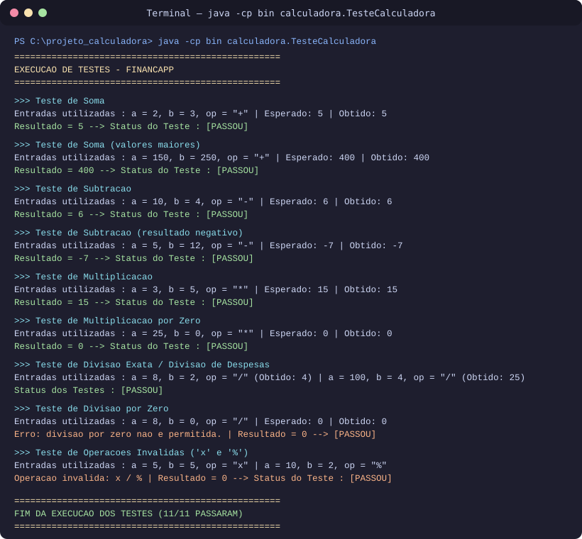
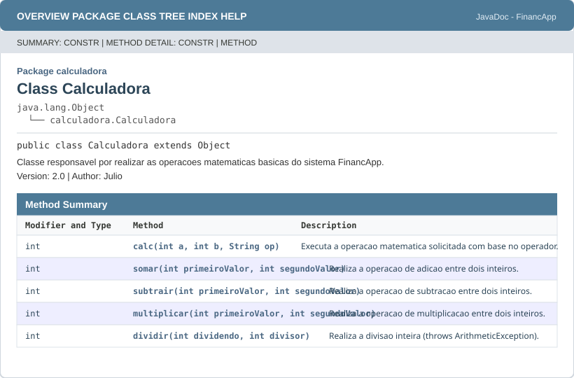

# Projeto Calculadora - FinançApp

## Descrição do Projeto
Este projeto foi desenvolvido durante a atividade prática de qualidade de software, simulando a criação de um módulo de cálculos básicos para a startup fictícia **FinançApp**, que atua no ramo de controle de finanças pessoais.

A ideia do módulo é centralizar as operações matemáticas que o aplicativo usa no dia a dia, como somar gastos do orçamento mensal, dividir despesas, projetar economias e calcular valores gerais do sistema.

## Objetivo da Atividade
O objetivo principal desta atividade foi colocar em prática conceitos importantes do desenvolvimento de software:
- Implementação de testes unitários e funcionais;
- Tratamento de erros (como divisão por zero e operadores inválidos);
- Refatoração de código em uma branch separada (`Refatoracao`);
- Documentação do código utilizando comentários técnicos e JavaDoc;
- Controle de versão com Git e publicação no GitHub.

## Tecnologias Utilizadas
- **Java (JDK)** - Linguagem utilizada para criar a calculadora e os testes.
- **JavaDoc** - Utilizado para gerar a documentação HTML na pasta `docs/`.
- **Git e GitHub** - Para versionamento do código e organização das branches (`main` e `Refatoracao`).

## Explicação das Operações
A classe `Calculadora` fica dentro do pacote `calculadora` e possui o método principal `calc(int a, int b, String op)`, que recebe dois números inteiros e o símbolo da operação desejada:

- **Soma (`+`)**: soma os dois valores informados (`a + b`).
- **Subtração (`-`)**: calcula a diferença entre o primeiro e o segundo valor (`a - b`).
- **Multiplicação (`*`)**: multiplica os dois valores (`a * b`).
- **Divisão (`/`)**: divide o primeiro valor pelo segundo (`a / b`). Possui uma validação para impedir a divisão por zero, exibindo uma mensagem de erro no console sem travar a execução do programa.
- **Operações inválidas**: caso seja passado algum operador diferente dos quatro esperados, o programa avisa que a operação é inválida e retorna `0`.

Na branch `Refatoracao`, o código inicial foi reorganizado extraindo métodos separados para cada operação (`somar`, `subtrair`, `multiplicar` e `dividir`), trocando a sequência de `if/else` por `switch` e melhorando os nomes das variáveis para facilitar a leitura.

## Prints da Execução dos Testes
Os testes foram criados na classe `TesteCalculadora.java`, testando as quatro operações básicas, a tentativa de divisão por zero e o envio de uma operação inválida, mostrando no console as entradas utilizadas, o resultado esperado e o resultado obtido.



Saída no terminal:
```text
--- Testes da Calculadora ---

Teste Soma: entradas (2, 3, '+')
Resultado esperado: 5
Resultado = 5
Resultado obtido: 5

Teste Subtracao: entradas (10, 4, '-')
Resultado esperado: 6
Resultado = 6
Resultado obtido: 6

Teste Multiplicacao: entradas (3, 5, '*')
Resultado esperado: 15
Resultado = 15
Resultado obtido: 15

Teste Divisao: entradas (8, 2, '/')
Resultado esperado: 4
Resultado = 4
Resultado obtido: 4

Teste Divisao por Zero: entradas (8, 0, '/')
Resultado esperado: 0 (mensagem de erro)
Erro: divisao por zero nao permitida
Resultado = 0
Resultado obtido: 0

Teste Operacao Invalida: entradas (5, 5, 'x')
Resultado esperado: 0 (mensagem de operacao invalida)
Erro: operacao invalida
Resultado = 0
Resultado obtido: 0
```

## Prints da Documentação JavaDoc
A documentação HTML foi gerada através do JavaDoc dentro do diretório `docs/`, com o arquivo `docs/index.html` funcionando como página inicial.



## Como executar o projeto
Para compilar e rodar os testes pelo terminal:
```bash
javac -d bin src/calculadora/*.java
java -cp bin calculadora.TesteCalculadora
```

Para gerar novamente a documentação JavaDoc:
```bash
javadoc -d docs -author -version -encoding UTF-8 -charset UTF-8 -docencoding UTF-8 -sourcepath src calculadora
```

## Link do Repositório
- Repositório no GitHub: https://github.com/neo666-bit/projeto_calculadora
